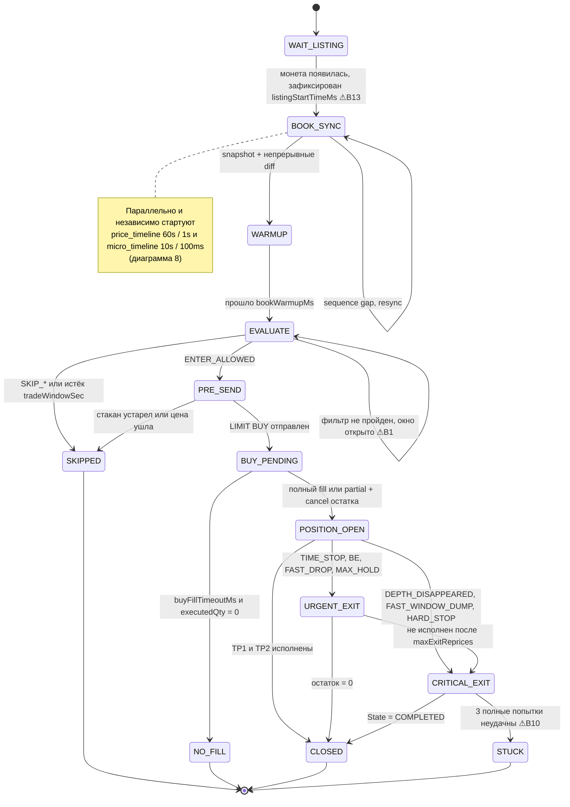
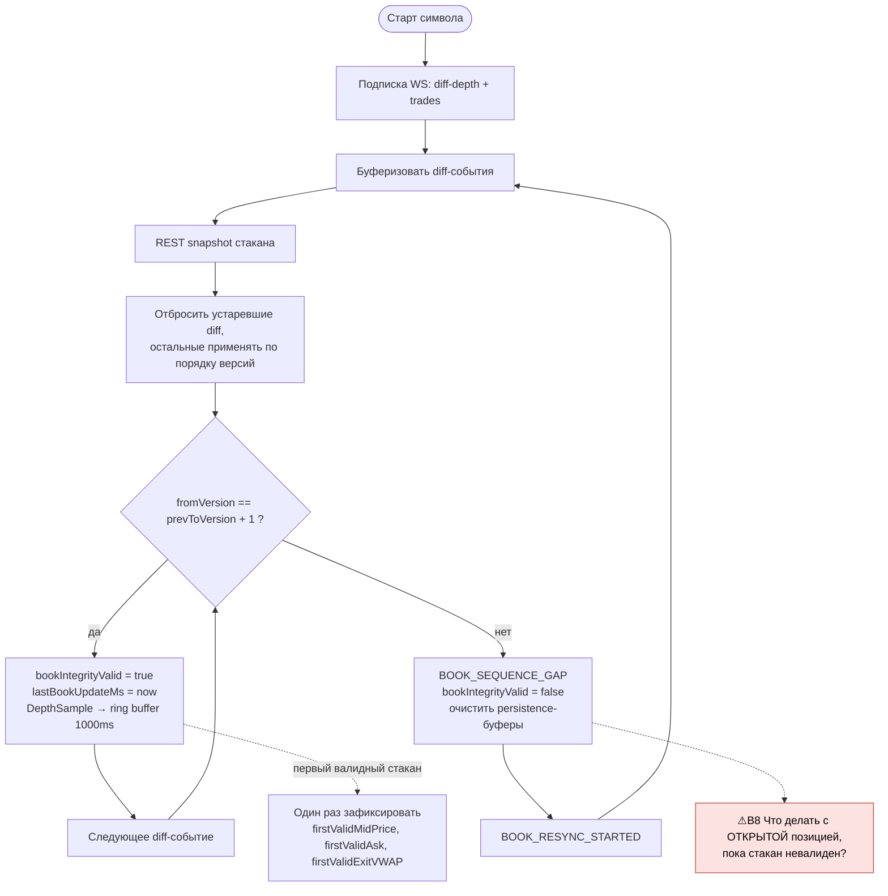
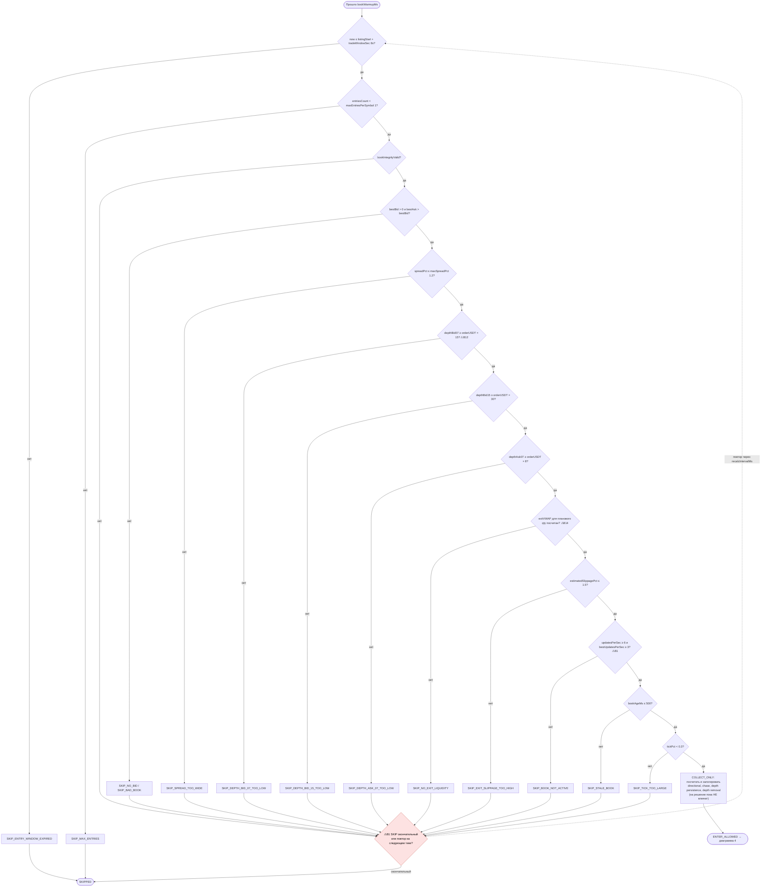
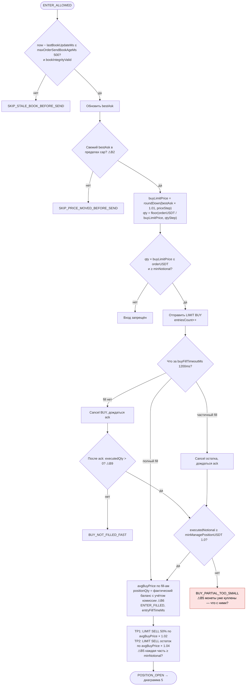
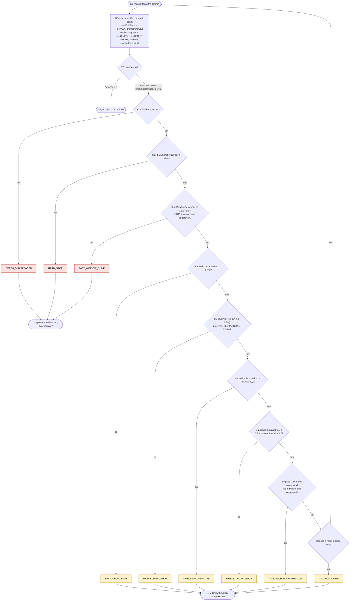
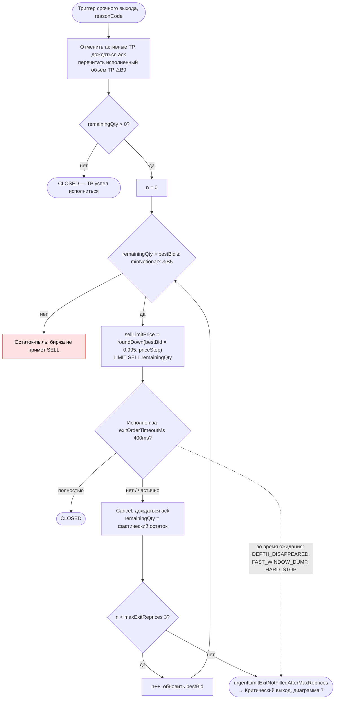
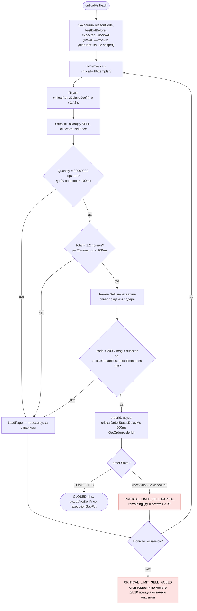
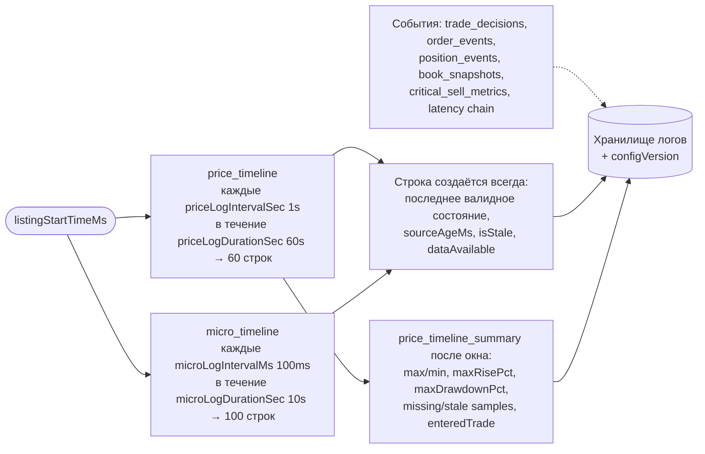

# Блок-схема стратегии торговли листингами MEXC (по ТЗ v2.1)

Источник: `logika_torgovli_listingov_mexc_v2_1_revised.pdf`. Где разделы ТЗ противоречат друг другу, используется v2.1 (разделы 10–22).

Пометки **⚠ Вn** ссылаются на найденные логические проблемы и открытые вопросы в конце документа.

> Просмотр в VS Code: расширение **Markdown Preview Mermaid Support** (`bierner.markdown-mermaid`), затем `Ctrl+Shift+V`.

---

## 1. Жизненный цикл одного листинга (верхний уровень)

---

## 2. Локальный стакан и его целостность (работает всё время)

---

## 3. Фильтры входа (EVALUATE)

---

## 4. Отправка LIMIT BUY и обработка fill

---

## 5. Сопровождение позиции (каждые recalcIntervalMs)

Порядок проверок в ТЗ не задан — ниже **предлагаемый** приоритет: сначала аварийные триггеры, затем защитные, затем временные.

---

## 6. Срочный выход: aggressive LIMIT SELL с перестановками

---

## 7. Критический выход: RequestSellOrderMinPrice (имитация MARKET SELL через веб-форму)

---

## 8. Независимое логирование (не останавливается при SKIP / CLOSED / critical)

---

## Найденные логические проблемы и вопросы к клиенту

> Ответы клиента (12.10.2026) и принятые решения — в [resheniya_po_voprosam.md](resheniya_po_voprosam.md).

### Критичные (влияют на деньги или делают логику неработоспособной)

**⚠В1. Фильтры входа проверяются один раз или повторно?** ТЗ не говорит, что происходит после SKIP внутри `tradeWindowSec`. Если проверка однократная, фильтр активности почти всегда даст отказ: `bookWarmupMs = 500`, а `updatesPerSec` считается за окно 1000 ms. При 100-ms потоке diff-depth за 500 ms приходит не больше 5 обновлений при пороге 6, то есть `SKIP_BOOK_NOT_ACTIVE` срабатывает всегда.
→ Предложение: повторять фильтры на каждом тике до конца `tradeWindowSec`; окончательный SKIP давать только для «жёстких» причин (`MAX_ENTRIES`, `WINDOW_EXPIRED`). Либо поднять warmup до 1000 ms или больше.

**⚠В2. `SKIP_PRICE_MOVED_BEFORE_SEND` никогда не сработает.** По ТЗ `buyLimitPrice` пересчитывается от *свежего* bestAsk, поэтому «bestAsk выше cap» невозможен: cap просто сдвигается вместе с ценой. Это и есть погоня за ценой, от которой ТЗ хочет защититься.
→ Предложение: брать за якорь `decisionAsk` (ask, на котором прошли фильтры). Если `freshAsk > decisionAsk × (1 + cap)`, то SKIP; в остальных случаях `buyLimitPrice` считать от `decisionAsk`.

**⚠В3. Time-stop срабатывает «в момент» или «начиная с момента»?** «Каждое действие должно срабатывать один раз» можно понять так: проверить ровно в t = 3 s. Тогда после 5 s (и до 15 s) позицию защищают только BE (если включён) и hard stop −8 %.
→ Предложение: условие `elapsed ≥ X` проверяется непрерывно, «один раз» относится только к самому выходу.
Отдельно: сразу после входа `netPnL ≈ −(spread + fees + проскальзывание входа) ≈ −0.7…−1.7 %`. При пороге −0.3 % `TIME_STOP_NEGATIVE` закроет почти каждую сделку, если цена за 3 s не вырастет примерно на 1 %. Уточнить у клиента, задумано ли так.

**⚠В4. «Импульс» для `TIME_STOP_NO_MOMENTUM` не формализован.** В ТЗ сказано только «рост цены, активный стакан, сохранение depthBid, исполнение TP». Нужна формула и пороги в конфиге.

**⚠В5. minNotional и мелкие остатки.** Частичный fill, деление на TP1/TP2 (по 50 %) и остатки после частичных SELL могут оказаться меньше минимального объёма ордера на бирже. Такой SELL биржа отклонит, и позиция «застрянет». Для `BUY_PARTIAL_TOO_SMALL` логика не описана, хотя монеты уже куплены.
→ Предложение: если позиция меньше 2 × minNotional, не делить её на TP1/TP2 и ставить один TP. Остаток меньше minNotional помечать как DUST и не пытаться продать.

**⚠В6. Комиссия BUY списывается в купленной монете.** Если не включена оплата комиссии в MX, фактический баланс меньше `executedQty`. Если выставить TP или SELL на `executedQty`, биржа ответит «insufficient balance».
→ `positionQty` брать из фактического баланса или из fills с учётом `commission` / `commissionAsset`.

**⚠В7. RequestSellOrderMinPrice на маленьком остатке не работает.** Форма ставит цену ≈ `1.2 / qty`. Если остаток по рынку стоит меньше 1.2 USDT, эта цена окажется *выше* рынка, и ордер не исполнится. Значит, «повторять критическую продажу для остатка» (требование v2.1) для мелких остатков не сработает. Кроме того, нужно проверить на реальной бирже, не отклоняет ли MEXC лимитные цены, слишком далёкие от рынка.

**⚠В8. Открытая позиция при невалидном стакане (gap / resync).** В это время `exitVWAP` и PnL не считаются, и ТЗ не говорит, что делать.
→ Предложение: на время resync заморозить стопы не дольше N ms (параметр в конфиге). Если стакан не восстановился за это время, запускать срочный выход по bestBid из REST.

**⚠В9. Гонки при отмене ордеров.** Fill может прийти между решением и отменой: у BUY по таймауту, у TP перед срочным выходом, у срочного SELL перед перестановкой. После каждой отмены нужно дождаться ack и перечитать `executedQty`. Иначе бот попытается продать больше, чем у него есть, или потеряет часть позиции из учёта.

**⚠В10. `CRITICAL_LIMIT_SELL_FAILED` оставляет позицию открытой.** По ТЗ бот после этого просто «останавливает торговлю по монете». Нужны алерт (Telegram) и либо ручное вмешательство, либо периодический повтор.

**⚠В11. Гибрид API и веб-формы (главный архитектурный вопрос).** `RequestSellOrderMinPrice` — это автоматизация браузера (в исходном проекте C#: `MxcWeb.cs`). Python-боту понадобится параллельно с API держать браузер с залогиненной сессией MEXC. Нужно уточнить у клиента: **доступна ли торговля новым листингом через API в первые секунды?** На MEXC для части новых пар API-торговля на старте бывает закрыта. Если закрыта, через веб придётся делать и вход, и все выходы, а это меняет всю архитектуру и задержки.

### Существенные

**⚠В12. Зоны depthBid считаются от midPrice, а продажа идёт по bestBid.** При spread 1.2 % bestBid = mid − 0.6 %, и в зону «−0.7 % от mid» попадает только 0.1 % ниже bestBid. При spread от 1.4 % bestBid оказывается ниже `lowerBid07`, и `depthBid07 = 0`. Получается скрытый, более жёсткий spread-фильтр.
→ Предложение: зоны bids считать от bestBid, зоны asks — от bestAsk.

**⚠В13. Не описан источник листингов.** Откуда бот узнаёт символ и `listingStartTimeMs`: анонсы MEXC, exchangeInfo, календарь? Также не заданы максимум одновременных листингов, распределение общего баланса и дневной лимит (`dailyLossLimitUSDT = null`).

**⚠В14. Порядок шагов.** Фильтр exitVWAP (шаг 7) требует плановый `qty`, а он вычисляется только на шаге 12. Для фильтра использовать оценку `qty ≈ orderUSDT / bestAsk`.

### Мелкие и неоднозначности

**⚠В15.**
- `hardMaxSpreadPct = 1.5` есть в конфиге, но в логике не используется.
- Окно действия `FAST_WINDOW_DUMP` не задано: только первые `fastDropWindowSec` или всё время удержания.
- Направление округления `roundToValidPrice` для TP не задано. Для TP логично округлять вверх, для стопов вниз.
- Приоритет при одновременном срабатывании нескольких триггеров не задан. На диаграмме 5 предложен порядок.

**⚠В16. Время выхода.** Срочный выход занимает примерно 4 × 400 ms плюс задержки cancel/ack, то есть около 2–3 s. Критический выход в худшем случае: 3 × 10 s + 3 s ≈ 33 s. При резком сливе на листинге это очень долго. Это не ошибка, но клиент должен понимать эти цифры.
